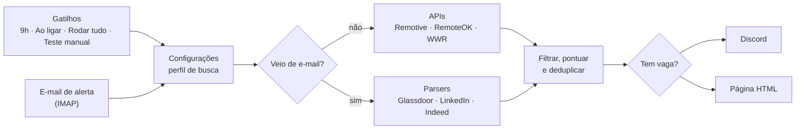
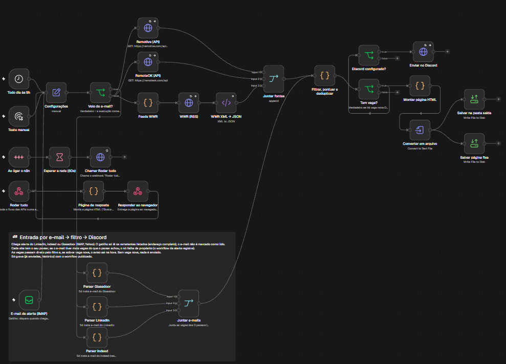
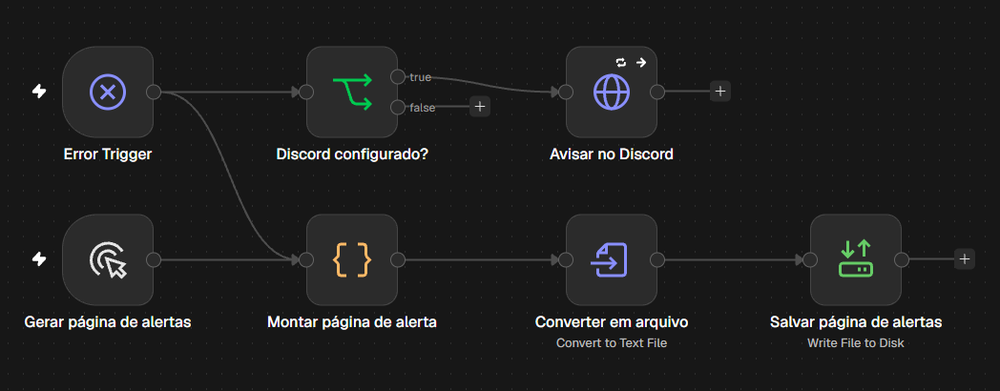
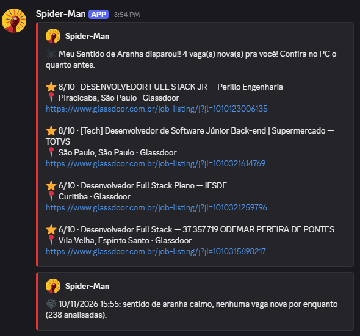
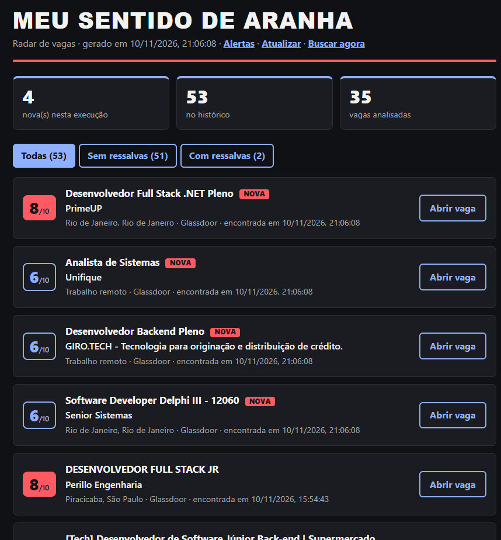
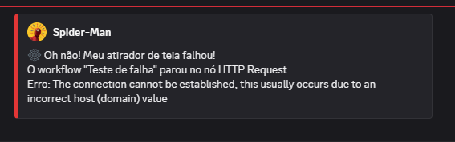
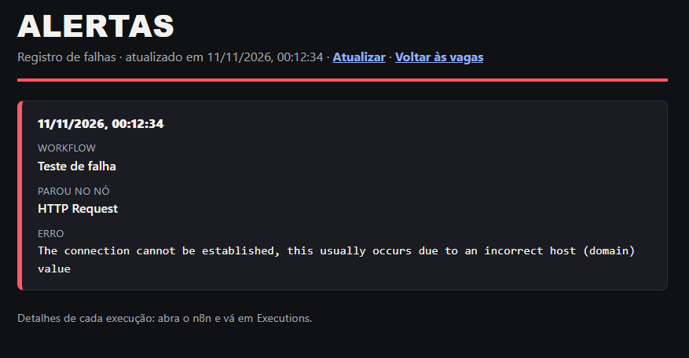

# Automação de vagas com n8n

Automação que busca vagas de desenvolvedor, filtra pelo meu perfil e avisa no Discord. Feita com n8n (self-hosted, em Docker), JavaScript e serviços gratuitos.

## 1. Sobre o projeto

Procuro recolocação como desenvolvedor full stack júnior/pleno há mais de um ano. Abrir vários sites de vagas todo dia cansa: as mesmas vagas aparecem de novo e a maioria nem serve (sênior, outra área, restrita a EUA ou Europa). Esta automação faz essa triagem por mim.

**O que ela faz**
- Busca vagas em duas APIs REST (Remotive e RemoteOK) e em um feed RSS (We Work Remotely).
- Lê os alertas de vaga que LinkedIn, Indeed e Glassdoor mandam por e-mail (IMAP).
- Filtra pelo meu perfil (JavaScript/TypeScript, React, Node, C#/.NET; Pelotas/RS ou remoto), descarta estágio, sênior e vagas restritas a EUA/Europa, dá uma **nota de 0 a 10** por regras e tira as repetidas.
- Avisa no **Discord** (webhook) e gera uma **página HTML** com o histórico das vagas. Quando não há vaga nova, também avisa, para eu saber que rodou.

**Quando roda:** todo dia às 9h; ao ligar o n8n (cobre o dia em que o PC estava desligado às 9h); assim que chega um alerta por e-mail; e sob demanda, por um link.

Tudo gratuito. Projeto final da disciplina de Automação e Programabilidade em Redes (SENAC, Análise e Desenvolvimento de Sistemas).

Autor: [@pedrohassen](https://github.com/pedrohassen)

## 2. Arquitetura e fluxo



<details>
<summary>Ver o canvas completo do n8n</summary>



</details>

<details>
<summary>Ver o canvas do workflow de alerta de falha</summary>



</details>

**Como o fluxo anda**
1. **Gatilhos.** Cinco formas de começar: o agendamento das 9h, o *Ao ligar o n8n*, o webhook *Rodar tudo* (usado pelo link "Buscar agora" da página), o *Teste manual* e o alerta de e-mail (IMAP).
2. **Configurações.** Um nó que só guarda o perfil de busca (palavras, nota mínima, tecnologias, locais). O filtro lê esses valores, então ajustar o perfil é mudar um campo, sem tocar em código.
3. **Veio de e-mail?** Um condicional: se a execução começou pelo IMAP, segue pelos parsers de e-mail; senão, pelas APIs.
4. **Fontes.** As APIs e o feed RSS (convertido de XML para JSON) entram em um *Juntar fontes*. Cada e-mail passa por um parser do site de origem, e os três entram em um *Juntar e-mails*. Se uma fonte falha, as outras seguem.
5. **Filtrar, pontuar e deduplicar.** Descarta o que não serve (senioridade, outra profissão, stack indesejada, local), dá a nota e remove repetidas (mesmo id, ou mesma empresa e título).
6. **Saídas.** Com vaga nova, o aviso vai ao Discord e a página HTML é atualizada. Nas rodadas das APIs sem vaga nova, o Discord recebe "nenhuma vaga nova". Num e-mail sem vaga nova, nada é enviado.
7. **Ao ligar o n8n.** Espera 60 s para a rede subir e chama o *Rodar tudo*. Essa volta é de propósito: o n8n grava a memória do workflow (vagas já enviadas, histórico, último e-mail lido) quando a execução termina, então, se a espera ficasse dentro da mesma execução, ela sobrescreveria o que um alerta de e-mail gravou nesse meio-tempo.

Um segundo workflow, de **alerta de falha**, avisa no Discord e registra numa página quando o principal quebra.

### Requisitos da disciplina

| Requisito | Como o projeto cumpre |
|---|---|
| Motor n8n e/ou Python | n8n, com JavaScript nos nós de código (parsers, filtro, nota, páginas) |
| Dois ou mais serviços em rede | REST (Remotive, RemoteOK), RSS/XML (We Work Remotely), IMAP (Yahoo) e webhook HTTP do Discord |
| Dados estruturados com lógica | JSON e XML→JSON, condicionais, filtro por regras, nota de 0 a 10 e deduplicação |
| Credenciais sem hardcode | A URL do webhook fica no `.env` (fora do Git); a senha do e-mail fica só no cofre de credenciais do n8n; o JSON exportado não tem segredo |
| Gatilho automático e saída concreta | Agendamento, *Ao ligar*, e-mail e webhook; saída em mensagem no Discord e página HTML |
| Tratamento de erros | 3 tentativas com limite de 15 s por pedido, e a execução segue sem a fonte que falhou; se nenhuma fonte trouxer vagas, o filtro falha de propósito e o workflow de alerta avisa |

### Limitações conhecidas
- Nos alertas de e-mail do LinkedIn e do Glassdoor só vêm título, empresa, local e link. O nível da vaga (por exemplo, sênior), que costuma estar na descrição, não entra na análise, então uma vaga sênior com título neutro pode passar. Vale conferir a descrição ao abrir.
- A nota é por regras (palavras e anos de experiência citados), não por IA.
- A memória das vagas já enviadas só persiste com o workflow publicado; execuções manuais não gravam.
- As fontes internacionais trazem poucas vagas júnior; o volume vem mais dos e-mails.
- O n8n local só roda com o PC e o Docker ligados. O gatilho *Ao ligar* recupera o que passou, e os e-mails ficam esperando no provedor.

## 3. Tecnologias e APIs

| Tecnologia | Para que serve | Custo |
|---|---|---|
| n8n (self-hosted) | Orquestra os fluxos | Grátis |
| Docker e Docker Compose | Roda o n8n de forma isolada e reproduzível | Grátis |
| JavaScript (nós Code) | Parsers de e-mail, filtro, nota e páginas HTML | Grátis |
| [Remotive API](https://remotive.com/api/remote-jobs) | Vagas remotas de software, em JSON | Grátis (até 4 consultas por dia) |
| [RemoteOK API](https://remoteok.com/api) | Vagas remotas, em JSON | Grátis |
| [We Work Remotely](https://weworkremotely.com) (RSS) | Vagas de programação, 3 feeds em XML | Grátis |
| IMAP (Yahoo) | Lê os alertas de LinkedIn, Indeed e Glassdoor | Grátis |
| Discord (webhook) | Avisos de vagas e de falhas | Grátis |

Remotive e RemoteOK pedem que a fonte seja citada e que se linke a vaga original: o resumo já faz isso. Não republico as vagas em outro site.

## 4. Pré-requisitos e como executar

**Pré-requisitos:** Docker Desktop (ou Docker com Compose). Opcionais: um webhook de canal do Discord e uma conta de e-mail com IMAP e senha de app, para os alertas de vaga.

1. **Clonar o repositório:**
   ```bash
   git clone https://github.com/pedrohassen/vagas-n8n.git
   cd vagas-n8n
   ```
2. **Criar o `.env`** a partir do exemplo (ele não vai para o Git):
   ```bash
   cp .env.example .env
   ```
   No PowerShell: `Copy-Item .env.example .env`.
3. **Preencher o `.env`:**

   | Variável | Para que serve |
   |---|---|
   | `DISCORD_WEBHOOK_URL` | URL do webhook do canal (opcional; vazio = só a página HTML). Funciona como senha |
   | `DISCORD_AVATAR_URL` | Foto que aparece nas mensagens (opcional) |
   | `TEMA` | `aranha` (padrão) ou `neutro` |
   | `GENERIC_TIMEZONE` | Fuso horário (padrão `America/Sao_Paulo`) |

4. **Subir o n8n:**
   ```bash
   docker compose up -d
   ```
   Abrir http://localhost:5678 e criar a conta local do n8n.
5. **Importar os dois workflows:** *Workflows → Import from file* com `workflows/vagas-workflow.json` e `workflows/alerta-de-falha-workflow.json`.
6. **Criar a credencial do IMAP** (opcional, só para os alertas por e-mail): *Credentials → Create → IMAP*, com o host do provedor, a porta 993 e uma senha de app. Depois escolher essa credencial no nó *E-mail de alerta (IMAP)*. O passo a passo para o Yahoo está em [`docs/configuracao.md`](docs/configuracao.md).
7. **Ligar o alerta de falha:** no workflow principal, *Settings → Error workflow* → "alerta de falha". Publicar os dois workflows (*Publish*), começando pelo de alerta.
8. **Testar:** abrir o workflow principal e executar o gatilho **Teste manual**. Conferir a mensagem no Discord e a página `saida/spider-man-ultimas-vagas.html`.

Para ajustar o perfil de busca (palavras, nota mínima, tecnologias), ver [`docs/configuracao.md`](docs/configuracao.md).

## 5. Demonstração


**Discord:** o aviso de vagas novas e o de "nenhuma vaga nova".



**Página de vagas:** histórico das últimas 200 vagas, com nota, filtros e link para a vaga original.



**Alerta de falha:** quando o workflow principal falha, o alerta avisa no Discord e registra a falha, com data, workflow, nó e erro, nesta página (guarda as últimas 50). Os exemplos abaixo vêm de uma falha provocada de propósito, por um workflow de teste que chama um endereço inexistente.





**Para ver funcionando:** no n8n, executar o *Teste manual*, ou abrir o link "Buscar agora" no topo da página de vagas. O resultado chega ao Discord e à página em poucos segundos.

## 6. Melhorias futuras
- **Rodar 24 h:** hospedar o n8n em uma máquina sempre ligada, para as buscas e os alertas não dependerem do meu PC estar ligado.
- **IA para avaliar o encaixe:** usar um modelo de linguagem com o meu currículo para decidir se a vaga combina comigo, em vez de só regras por palavras. Seria um modelo local ou um resumo do perfil, sem dados pessoais, mantendo as regras atuais como primeiro filtro.
- **Lista separada de estágios:** em vez de descartar, mostrar as vagas de estágio numa lista à parte na página, fora dos avisos do Discord.
